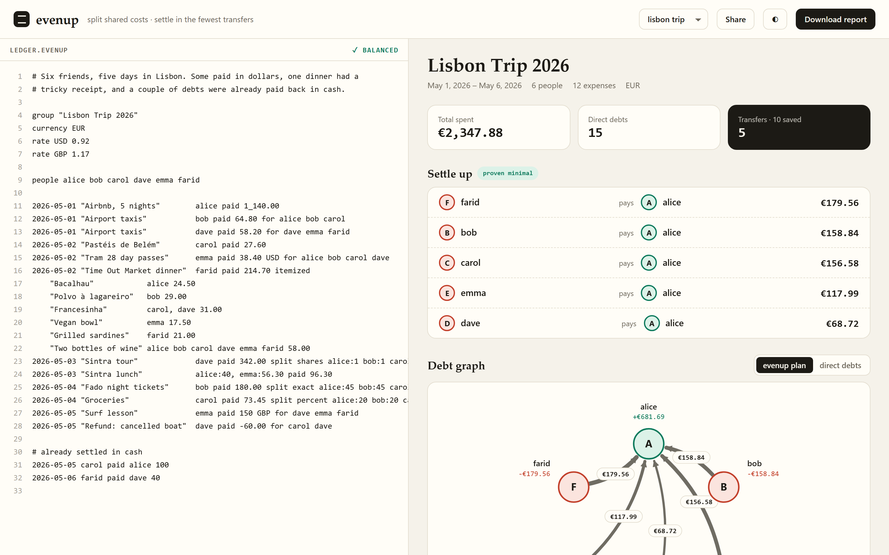
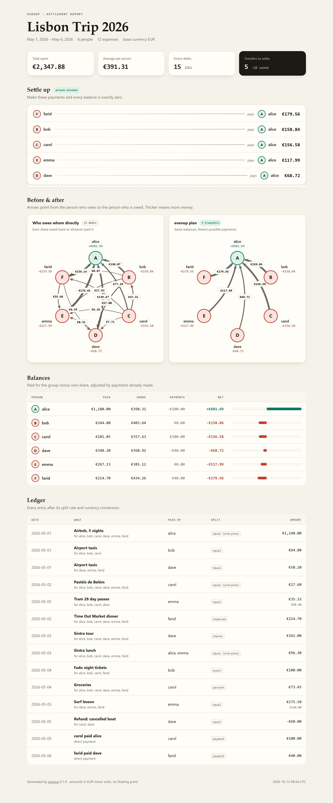

<div align="center">

# evenup

**Split shared costs to the cent and settle them in the fewest possible transfers.**

Write down a group trip, a flat share or a dinner bill as plain text. evenup applies each split rule without losing a cent, converts currencies, and then finds the payment plan that settles the whole group with the fewest transfers. It is an NP-hard problem, solved exactly.

[](https://github.com/ardazeybek-dev/evenup/actions/workflows/ci.yml)
[](https://fsharp.org)
[](LICENSE)
[](https://ardazeybek-dev.github.io/evenup/)

<picture>
  <source media="(prefers-color-scheme: dark)" srcset="docs/images/playground-dark.png">
  
</picture>

</div>

## The everyday problem

Six friends spend five days in Lisbon. Someone books the flat, someone pays for taxis in dollars, and one dinner comes on a single receipt with a tip on top. Two people have already paid each other back in cash. At the end of the trip:

- **Who owes what?** Splitting €100 three ways leaves a cent over. Splitting a tip fairly means splitting it in proportion to what each person ordered. Dollars have to become euros without the totals drifting.
- **How do we pay it back?** If everyone repays each payer directly, that's 15 separate transfers. The minimum is 5. Finding that minimum is NP-hard: it is equivalent to finding as many disjoint zero-sum subsets as possible.

evenup does both, in a format you can read, diff and keep in git:

```text
group "Lisbon Trip 2026"
currency EUR
rate USD 0.92
people alice bob carol dave emma farid

2026-05-01 "Airbnb, 5 nights"       alice paid 1_140.00
2026-05-02 "Tram 28 day passes"     emma paid 38.40 USD for alice bob carol dave
2026-05-02 "Time Out Market dinner" farid paid 214.70 itemized
    "Bacalhau"            alice 24.50
    "Francesinha"         carol, dave 31.00
    "Two bottles of wine" alice bob carol dave emma farid 58.00
2026-05-03 "Sintra tour"            dave paid 342.00 split shares alice:1 bob:1 carol:1 dave:1 emma:1 farid:1
2026-05-05 carol paid alice 100
```

```console
$ evenup settle examples/lisbon-trip.evenup

  Lisbon Trip 2026
  May 1, 2026 – May 6, 2026 · 6 people · 12 expenses · total €2,347.88

  SETTLE UP  5 transfer(s) instead of 15 direct debts · optimal
    farid → alice  €179.56
    bob   → alice  €158.84
    carol → alice  €156.58
    emma  → alice  €117.99
    dave  → alice   €68.72
```

## Features

| | |
|---|---|
| 🧮 **Exact money** | Every amount is an `int64` of minor units, and there is no floating point anywhere. Splits use the largest-remainder method, so parts always add up to the total and stay within one cent of fair. |
| 🧾 **Real-world split rules** | Equal, among a subset, by shares, by percent, exact amounts, and **itemized receipts**, where tax and tip follow each person's subtotal. Several payers per expense, refunds, and payments already made. |
| 💱 **Multi-currency** | Zero- and three-decimal currencies (JPY, KWD) are supported. Each expense's total is converted once and then re-allocated, so balances still add up to zero after conversion. |
| 🎯 **Provably minimal plan** | An O(2ⁿ·n) subset DP finds the most zero-sum groups, which gives the fewest transfers. Property tests check it against brute force. Larger groups get a bounded hybrid. [How it works →](docs/algorithm.md) |
| 🛑 **Compiler-grade errors** | Every mistake is reported with its line and column, a caret under the problem, and suggestions like *"unknown person 'bbo' — did you mean 'bob'?"* |
| 📊 **Visual reports** | A single offline HTML file with before/after SVG debt graphs, balance bars and the full ledger. It follows light and dark mode and prints cleanly. [Sample →](https://ardazeybek-dev.github.io/evenup/) |
| 🌐 **Playground and API** | `evenup serve` starts a live editor that recalculates as you type and can share a ledger as a link, plus a small JSON API. [API docs →](docs/api.md) |
| 🌍 **Locale-proof** | Parsing and formatting ignore the machine's culture, so `12.50` means the same on a Turkish or German system. Names can be in any script (`ayşe`, `zoë`). |

<p align="center">
  
</p>

## Quick start

You need the [.NET 10 SDK](https://dotnet.microsoft.com/download).

```bash
git clone https://github.com/ardazeybek-dev/evenup.git
cd evenup
dotnet build -c Release

# run from source
dotnet run --project src/Evenup -- settle examples/lisbon-trip.evenup

# or install the `evenup` command globally
dotnet pack src/Evenup -c Release -o out
dotnet tool install --global evenup --add-source ./out
```

### Commands

```text
evenup settle <file|->  [--format table|json|md] [--exact-limit N] [--greedy]
evenup report <file|->  [-o report.html]       # self-contained HTML report
evenup check  <file|->                         # validate only; exit code 1 on errors
evenup serve            [--host H] [--port N]  # playground + JSON API
evenup example [name]                          # list / print bundled examples
evenup init   [file]                           # write a starter ledger
```

`-` reads the ledger from stdin, so `cat trip.evenup | evenup settle - --format json | jq` works.

### Docker

```bash
docker build -t evenup .
docker run --rm -p 8080:8080 evenup          # playground at http://localhost:8080
```

## Configuration

`evenup` reads a `.env` file from the current directory. Variables already set in the real environment take precedence over it. Copy [`.env.example`](.env.example) to get started.

| Variable | Default | Purpose |
|---|---|---|
| `EVENUP_HOST` | `127.0.0.1` | Interface for `serve` (`0.0.0.0` in containers) |
| `PORT` | `5317` | Port for `serve` |
| `EVENUP_EXACT_LIMIT` | `20` | Largest number of people with a balance that is solved exactly (max 22) |
| `EVENUP_MAX_BODY_KB` | `256` | Largest request body the API accepts |
| `EVENUP_CORS_ORIGINS` | *(empty)* | Comma-separated browser origins allowed to call the API |
| `EVENUP_LOG_LEVEL` | `Warning` | ASP.NET Core log level |
| `NO_COLOR` | *(unset)* | Turns off colored terminal output |

## Ledger format in one minute

```text
alice paid 90                              # equal split among everyone
alice paid 90 for bob carol                # equal split among bob and carol
alice paid 90 split shares alice:2 bob:1   # proportional
alice paid 90 split percent alice:60 bob:40
alice paid 90 split exact alice:50 bob:40
alice:50, bob:40 paid 90                   # two payers
alice paid 50 USD                          # needs `rate USD …`
alice paid -20                             # refund
bob paid alice 30                          # money already paid back
farid paid 74.80 itemized                  # receipt; tax/tip follow subtotals
    "Pizza"  alice 18.50
    "Pasta"  bob, carol 22.00
```

Full reference: [docs/format.md](docs/format.md).

## Project layout

```text
evenup/
├── src/
│   ├── Evenup.Core/        # pure library, no I/O
│   │   ├── Money.fs        #   minor units, parsing, largest-remainder allocation, FX
│   │   ├── Domain.fs       #   ledger types
│   │   ├── Parser.fs       #   .evenup text → Ledger, with line/column diagnostics
│   │   ├── Engine.fs       #   split rules, currency conversion, balances, direct debts
│   │   ├── Settle.fs       #   subset-DP optimal solver, greedy, hybrid
│   │   ├── Svg.fs          #   dependency-free debt-graph renderer
│   │   └── Report.fs       #   JSON DTO, Markdown, self-contained HTML report
│   └── Evenup/             # the `evenup` executable
│       ├── Config.fs       #   .env loader + settings
│       ├── Terminal.fs     #   colored tables and compiler-style errors
│       ├── Server.fs       #   ASP.NET Core minimal API
│       ├── Program.fs      #   command-line interface
│       └── playground/     #   single-file web UI, embedded in the binary
├── tests/Evenup.Tests/     # xUnit + FsCheck property tests
├── examples/               # sample ledgers (also bundled into the binary)
├── docs/                   # format, algorithm and API references
└── .github/workflows/      # CI on Linux/Windows/macOS + Docker smoke test + Pages
```

## Testing

```bash
dotnet test
```

The 45 tests cover:

- **money**: rounding, exponents, and tr-TR culture safety;
- **the parser**: every construct, plus error positions;
- **split rules**: including tax and tip spreading, and currency conversion;
- **rendering**: HTML escaping and JSON shape.

Property-based tests (FsCheck) check that:

- allocations always add up to the total and stay within one unit of the ideal share;
- every plan settles every balance;
- no plan uses more than *n − 1* transfers;
- the optimal solver never does worse than greedy;
- the optimal solver matches a brute-force partition search on small groups.

## ⚠️ Gotchas

- **`unknown person` error for a name you meant to add** → once a `people` line exists, it is the full member list → add the name to it, or delete the line so people are inferred from the entries.
- **`has more than 2 decimal place(s)`** → amounts are checked against the currency's minor unit → round the amount, or check whether the currency should be a zero-decimal one like JPY.
- **The plan says `hybrid` instead of `proven minimal`** → more people have a balance than `EVENUP_EXACT_LIMIT` → raise the limit (up to 22; memory doubles with each step) or accept the near-optimal plan.

## License

[MIT](LICENSE) © Arda Zeybek
